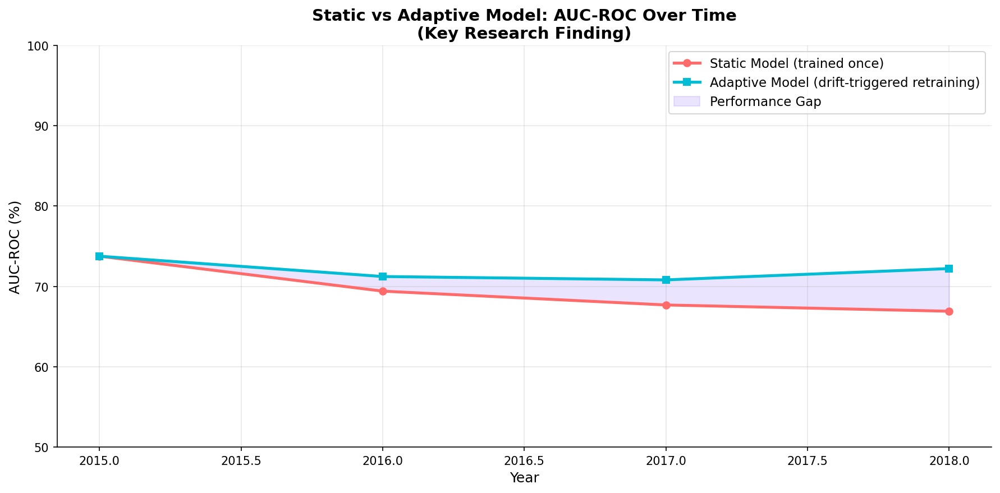
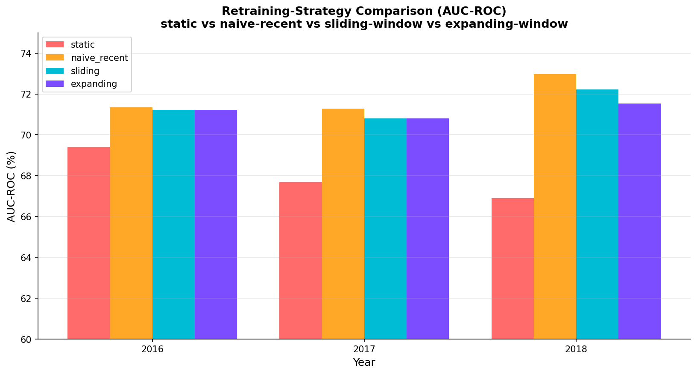

# Adaptive Credit Risk Scoring with Concept Drift Detection

Author: Pranav Sri Vasthav Tenali Gnana (M25DE1069)
Institute: Indian Institute of Technology Jodhpur, M.Tech Computer Science Engineering

**Stack:** Python · XGBoost · LightGBM · scikit-learn · SHAP · MLflow · DVC · Streamlit · pytest

A credit-risk model trained once and left alone goes stale. As borrower behaviour
and the lending market shift over time, a model's ability to separate good loans
from bad ones decays. This project measures that decay on real Lending Club data,
detects the underlying drift with several independent methods, and shows that
retraining on recent data recovers most of the lost performance.

## What the project does

The pipeline trains a baseline default-risk model on 2015 loans, then tracks how it
behaves on 2016, 2017, and 2018. Three things happen in parallel: the static model
is evaluated year by year to quantify how much it degrades, a battery of drift
detectors decides when a retrain is warranted, and an adaptive model is retrained on
a sliding window of recent years and compared head to head with the static one on
the same held-out test set.

Two common objections are answered directly. Is F1 hiding the
truth? F1 at a fixed 0.5 cutoff is reported alongside PR-AUC and an F1 at a
validation-tuned threshold, so the base-rate artifact is visible rather than swept
under the rug. Would naive retraining work just as well? Three retraining policies
are benchmarked, not one.

## Results

The static 2015 model loses about 9.8% of its AUC by 2018 (0.7422 down to 0.6695)
when never retrained. Drift is real and it grows.

Retraining recovers most of that loss. On the same leakage-free held-out test split:

| Year | Static AUC | Adaptive AUC | AUC gain | PR-AUC gain |
|------|-----------|--------------|----------|-------------|
| 2016 | 0.6941 | 0.7123 | +0.0182 | +0.0403 |
| 2017 | 0.6769 | 0.7081 | +0.0312 | +0.0445 |
| 2018 | 0.6691 | 0.7222 | +0.0531 | +0.0741 |

The gain grows as drift accumulates, and adaptive wins on AUC, on the threshold-free
PR-AUC, and on F1 once the threshold is tuned.



The retraining-strategy comparison turns up a more interesting result than expected:
recency beats volume. Retraining on just the most recent year is the strongest
option, the three-year sliding window is close behind, and the expanding window that
keeps all history is the weakest adaptive strategy by 2018 (0.7297, 0.7222, 0.7154
respectively). Keeping stale 2015-16 data around actively hurts once drift sets in.
The sliding window is deployed because it bounds memory without needing the optimal
lookback known in advance.



## Drift detection

Drift is flagged by four methods that agree with each other. The Population
Stability Index marks `int_rate` (2017) and `revol_util` plus `int_rate` (2018) as
critically shifted. A KS test on the label confirms the default rate climbing from
20.5% to 27.2%. Jensen-Shannon distance gives a bounded per-feature second opinion.
A classifier two-sample test trains a model to tell 2015 apart from each later year;
its AUC rises from 0.977 to 0.999.

That last number is worth dwelling on. The most drifted single feature reaches only
about 0.65 univariate AUC, yet the classifier separates the years almost perfectly.
The drift is multivariate, and per-feature PSI, which flags at most two features,
badly understates it. The trigger-policy table makes a related operational point:
because drift fires every year here, drift-triggered retraining coincides with
periodic yearly retraining on this data. The trigger earns its keep by skipping
retrains when the data is quiet, which a PSI-only policy would do in 2016.

## Explainability stability

SHAP importances of the static model stay stable in aggregate (cosine similarity
above 0.95, Kendall tau above 0.8 every year), but the top-10 membership churns:
Jaccard@10 drops to 0.818 in 2017 and 2018 as `int_rate` climbs into the top ten,
tracking its PSI drift. The interpretable signal corroborates the metric drop.

## Repository layout

```
configs/config.yaml          all hyperparameters, drift thresholds, paths
src/
  data/preprocess.py         cleaning and yearly-window feature engineering (Phase 1)
  models/train.py            train XGBoost, LightGBM, Logistic Regression
  models/evaluate.py         AUC, PR-AUC, F1, the static-vs-adaptive backtest
  drift/psi.py               Population Stability Index
  drift/ks_test.py           Kolmogorov-Smirnov label test
  drift/advanced_detectors.py  Jensen-Shannon distance, classifier two-sample test
  drift/detector.py          drift pipeline that combines all detectors
  explainability/shap_analysis.py  SHAP values and stability metrics
  mlops/                     retraining helpers and MLflow logging
run_phase2.py ... run_phase5.py   the canonical pipeline drivers (see below)
dashboard/                   Streamlit results UI with a live drift demo
outputs/
  models/                    saved models and tuned thresholds
  reports/                   drift, comparison, SHAP, and the consolidated summary
  plots/                     all result charts
```

## Setup

The project uses Python 3.11 with the stack pinned in `requirements.txt` (XGBoost
2.0.3, scikit-learn 1.5.2, NumPy 1.26.4, MLflow 2.12.1, Streamlit 1.39.1, and
others). On Windows the working interpreter is `venv\Scripts\python.exe`.

```bash
python -m venv venv
venv\Scripts\activate          # Linux/macOS: source venv/bin/activate
pip install -r requirements.txt
```

The dataset is not in this repository (about 1.7 GB). Download the Lending Club CSV
from Kaggle at https://www.kaggle.com/datasets/wordsforthewise/lending-club (2007 to
2018) and place it at `data/raw/lending_club.csv`. Trained models, reports, and plots
are committed under `outputs/`, so the results can be inspected without re-running
training; the dashboard's built-in drift windows need the dataset and Phase 1.

Run the drift-detector unit tests with `pytest tests/`.

## Running the pipeline

The pipeline runs as a sequence of phase drivers. Run them from the project root in
order:

```bash
venv\Scripts\python.exe src/data/preprocess.py   # Phase 1: clean + build windows
venv\Scripts\python.exe run_phase2.py            # baseline model training
venv\Scripts\python.exe run_phase3.py            # drift detection + degradation
venv\Scripts\python.exe run_phase4.py            # adaptive retraining + SHAP
venv\Scripts\python.exe run_phase5.py            # backtest + final_summary.txt
```

Phase 4 is the heavy one (around 17 minutes; it fits nine SMOTE-balanced models and
runs SHAP). The others finish in seconds to a couple of minutes. The legacy
`main.py` and `src/mlops/retrain.py` are an older orchestration path that the phase
drivers deliberately replace, because that path evaluated the adaptive model on a
mixed test split rather than a leakage-free held-out one. Use the phase drivers.

Experiment tracking goes to MLflow. Launch the UI with `venv\Scripts\python.exe -m
mlflow ui` and open http://localhost:5000.

## Dashboard

An interactive Streamlit dashboard presents every result and runs the detectors and
models live. Launch it with `run_dashboard.bat`, or:

```bash
venv\Scripts\python.exe -m streamlit run dashboard/app.py
```

Then open http://localhost:8501. The Live Drift Check page lets you pick a built-in
window or upload a CSV, runs the drift detectors against the 2015 reference in real
time, and scores the data with the static and adaptive models side by side. Built-in
windows are scored on the same held-out test split as the thesis, so the numbers
match; uploads are scored in full. See `dashboard/README.md` for page-by-page notes.

## Limitations

The Lending Club public release ends in 2018, so the COVID-era shock, the most
extreme recent credit drift, can't be tested here. The work covers a single market
(US unsecured consumer loans) at yearly granularity, where real monitoring would run
monthly. Only matured loans with a resolved Fully Paid or Charged Off status are
used, which under-represents the most recent originations. SMOTE balances the
training data and thresholds are tuned on a held-out validation split, but the
probability outputs aren't calibrated and would need isotonic or Platt scaling
before being read as probabilities. Because drift fires every year on this data, the
trigger can't be shown here to reduce retraining frequency against a periodic
schedule, only to avoid retraining when a single detector is quiet.

## Background

The framing builds on "Fair and Explainable Credit-Scoring under Concept Drift"
(Shivogo, 2025, arXiv:2511.03807), extending it with a drift-triggered retraining
loop, multi-method drift detection, SHAP stability monitoring, a multi-year
backtest, and MLflow-based experiment tracking.
